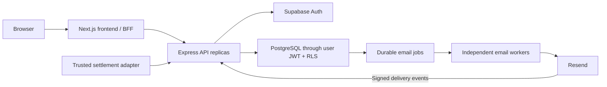
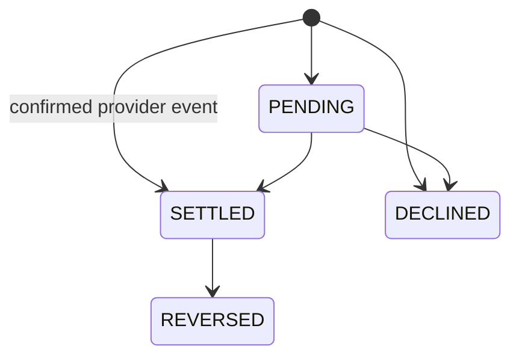

# Architecture and scaling

## Application boundaries

Account APIs are stateless between requests. They use shared PostgreSQL state and persistent Auth session revocation, so replicas need no sticky sessions or shared local files. SQLite is exclusively a single-instance demonstration engine.

## Code map

| Location | Responsibility |
| --- | --- |
| [app composition](../src/app.ts) | Middleware, dependencies, health and route registration |
| [configuration](../src/config.ts) | Environment validation and safe production defaults |
| [auth gateway](../src/services/auth-gateway.ts) | Request-scoped Supabase Auth REST transport |
| [auth middleware](../src/middleware/supabase-auth.ts) and [account checks](../src/middleware/account-auth.ts) | Verified identity, revocation and optional device trust |
| [versioned routers](../src/routes/features/) | Validate requests, call services/RPCs and present responses |
| [contracts](../src/contracts/features.ts) and [input validation](../src/lib/feature-validation.ts) | Record types and strict request schemas |
| [paged access](../src/services/feature-store.ts), [transactions](../src/services/transactions.ts) | Ownership filters, stable pagination and complete reports |
| [migrations](../supabase/migrations/) | Tables, indexes, constraints, grants, RLS and atomic operations |
| [documents](../src/services/documents.ts) | Escaped HTML, formula-safe CSV and dependency-free PDF |
| [provider webhooks](../src/routes/provider-webhooks.routes.ts) | Verify raw-byte signatures before privileged settlement writes |
| [email service](../src/services/email.ts) and [worker](../src/workers/email-worker.ts) | Bounded claims, provider calls and fenced completion |
| [tests](../tests/) | Unit, HTTP, PostgreSQL/RLS and transport regression coverage |

Keep business invariants in PostgreSQL when several records must change together. Routers remain thin. Services accept dependencies instead of importing global clients or opening their own databases.

## Data and identity

Application records reference `auth.users`; credentials stay in Supabase Auth. The initial migration creates profiles/categories/subscriptions. Subsequent migrations add account features, support/summaries, then the email outbox.

All new tables enable RLS and explicitly revoke anonymous and broad user privileges. User-facing queries use `forUser(accessToken)` and derive owners from a verified identity, never request bodies. Composite foreign keys prevent linking a pool/payment to another user's subscription.

Ledger values, pool balances, accepted membership, invite hashes, device hashes, support authors/roles and delivery state cannot be edited directly by authenticated clients. Narrow `SECURITY DEFINER` functions enforce identity/state invariants, use an empty search path and have explicit execute grants. Trusted provider/worker functions are executable only by `service_role`.

Support staff membership is administered separately. Active staff can read the support inbox, not customer financial/account tables. Disabling staff removes inbox privileges on subsequent requests.

## Money and state

Individual amounts are integer minor units; request schemas accept up to `1_000_000_000_000`. Database financial constraints additionally guard the JavaScript safe integer range. Aggregates use PostgreSQL `numeric` and serialize exact decimal integer **strings**. NGN and USD stay separate; no invented exchange rate is applied.

Pool targets and shares are snapshots of a subscription at creation. A pool represents one contribution cycle in this release. Updating a subscription does not rewrite accepted shares or automatically open another cycle.

Contribution creation locks the pool and member. A unique idempotency key plus a partial unique index permits one pending/settled request per member. Confirmation locks records in the same order, validates amount/currency, records the provider event and atomically updates the contribution, member and pool. Failed requests can be retried with a new key. A failed request cannot later be converted to a settlement; reconciliation must create a separately validated operation.

Transactions store immutable ownership, amount, merchant and business classification snapshots. Allowed transitions are:

Repeated identical states are safe. Event IDs cannot be reused with different payloads. Only `SETTLED` transactions expose receipts or contribute spend amounts; reversing one removes its current receipt eligibility and spend total.

Provider webhooks persist confirmed records; they do not themselves perform bank funding, currency conversion, card issuance or issuer JIT authorization. These integrations remain separate provider/financial-engine work.

## Query costs and reports

Collections use descending `(created_at, id)` keyset pagination, a maximum page size of 100, indexed owner/date predicates and no growing OFFSET. Cursors retain PostgreSQL microsecond precision so timestamp ties cannot skip records. Opaque cursors are scoped to the user/resource/filters. They are bookmarks, not authorization credentials.

The demo Dashboard remains a latest-100 activity feed. Complete history uses `/api/transactions`; complete account history uses `/api/v1/transactions`. Aggregates query every record in the period. Month boundaries are UTC and half open: `from <= created_at < to`.

Account CSV exports traverse every matching page, streaming with backpressure and bounded application memory. PDF exports cap at 5,000 receipts before sending headers. Larger reports use CSV. PDF rendering uses a standard built-in font and ASCII fallback; HTML and CSV retain full Unicode text.

Current history, aggregates and exports reflect settlement/reversal state at query time. Separate requests can change as new provider events arrive. A monthly summary is an immutable snapshot at generation; repeated generation returns that snapshot. It does not automatically refresh after late settlements or reversals. For current figures, query the live period summary.

## Device and session revocation

Registration associates a random 256-bit trust token with the **signed Auth session_id**. Only its SHA-256 hash is stored. Re-registration rotates the token; it cannot restore a revoked session. Tokens expire after 30 days.

A caller may send `X-Retrest-Device-Token` to require valid device trust. It must belong to the same verified account and Auth session. Device removal also inserts persistent session revocation, so omitting this header cannot restore API or direct PostgREST access. Login creates a new session; refreshing the removed device's session remains denied.

Registration trusts an already authenticated session. It is not an OTP or hardware attestation flow, and it does not claim to implement a second authentication factor.

## Email outbox

Summary email requests resolve the recipient from the confirmed Auth account on the server. Clients cannot select another recipient or edit delivery state. API replicas enqueue and return job status; workers perform the external call.

The worker schedules the last completed UTC month in batches of at most 100 verified opted-in accounts, checking every minute and draining full batches immediately. Account row locks, a unique per-account/month email key and the same advisory summary lock as manual generation protect concurrent workers. Existing immutable summaries are reused. Automatic jobs are cancelled before another attempt if the account opts out or the confirmed address changes. Scheduling requires the additive [scheduling migration](../supabase/migrations/20261123000000_scheduled_summaries.sql); `MONTHLY_EMAIL_SCHEDULING_ENABLED=false` disables automatic queuing without stopping explicit email delivery.

Workers claim at most four jobs with `FOR UPDATE SKIP LOCKED`. Claims have 120-second leases and unique fencing tokens. Completion must match the current unexpired claim. Crashed workers leave recoverable leases, while stale workers cannot overwrite a newer claim.

Transient failures back off exponentially, with at most five attempts. Every retry uses the same Resend idempotency key. Uncertain sends stop after 23 hours, before [Resend's 24-hour idempotency retention](https://resend.com/docs/dashboard/emails/idempotency-keys). A failed/expired job is never automatically requeued indefinitely.

HTTP success produces `ACCEPTED`, not `DELIVERED`. Verified Svix events confirm delivery/bounce/failure. Events arriving before worker completion are retained and applied later. Bounce/failure feedback takes precedence over a delayed delivery event.

`FAILED` means processing stopped or a provider failure was confirmed; an uncertain network outcome can still require provider-side reconciliation. Do not manually resend an uncertain job without checking its provider idempotency key.

## Operational scaling

- Deploy multiple API replicas and independent workers against the same Supabase project.
- Terminate TLS at a trusted ingress and configure exact proxy CIDRs/origins.
- Use the ingress/API gateway for shared quotas, or inject an atomic shared [RateLimitStore](../src/middleware/rate-limit.ts). The built-in limiter bounds memory and limits each replica; its counts are not shared.
- Monitor readiness failures, 5xx/429 rates, request latency, queue age, expired leases, failed emails and webhook conflicts.
- Retain transaction/provider-event IDs for replay protection. Remove revoked session entries only after the associated Auth session can no longer refresh.
- Set data retention for closed support threads, old device records, terminal email jobs/events and summary snapshots according to the product's needs. Prune terminal jobs/events together after the reconciliation period.

Structured request logs include an opaque request ID, route template, status and latency. They omit request bodies, JWTs, invite/device tokens and provider credentials.
